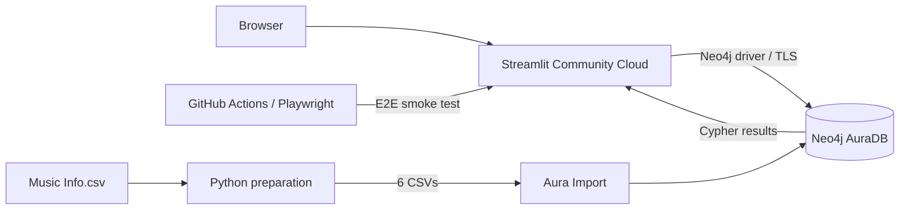
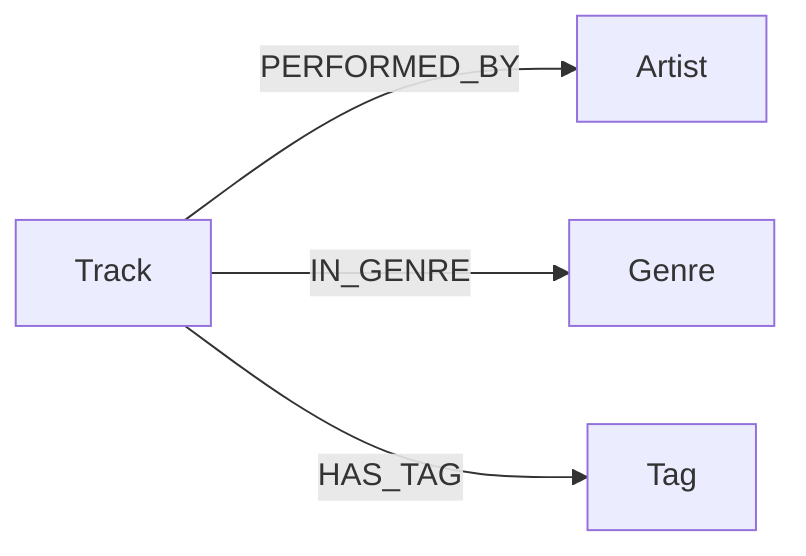
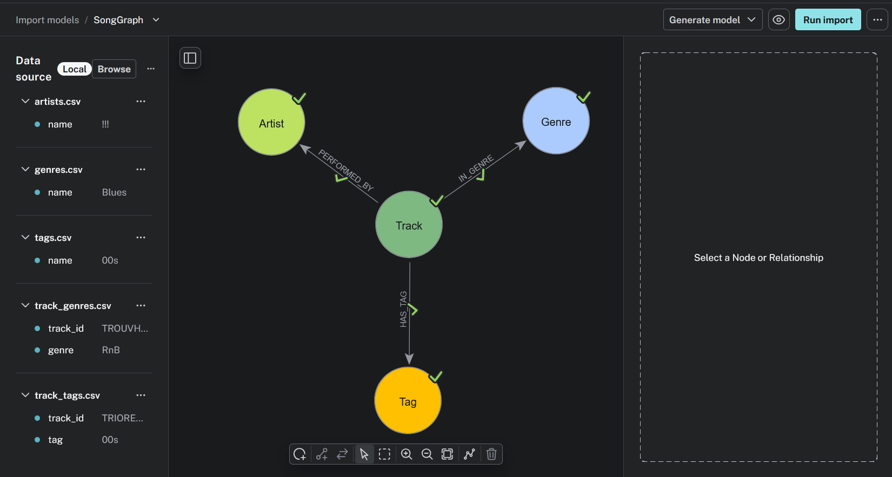
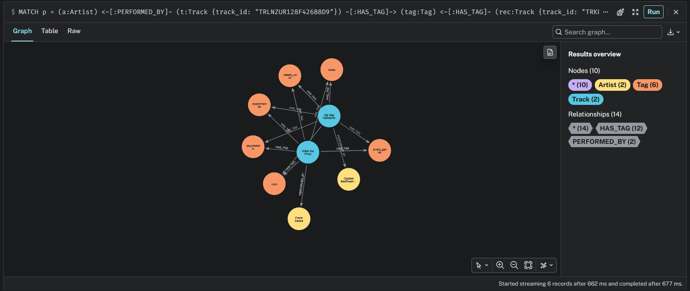

# SoundGraph


**Discover music through connections.** An explainable content-based music recommender built with Neo4j and Cypher for the Neo4j + DIO bootcamp.

[**Live demo**](https://soundgraph.streamlit.app/) · [Português](README.md) · [Validation (PT)](docs/validation.md)

[](https://github.com/mneves0988/sistema-recomendacao-musical/actions/workflows/soundgraph-smoke.yml)

> The demo runs on free tiers. Streamlit may sleep and AuraDB may require manual reactivation by the owner. Temporary smoke monitoring does not guarantee uptime.

## Problem and approach

How can we discover related tracks and artists without listening history? SoundGraph combines explicit graph connections between tracks, artists and tags with audio features, showing shared evidence for each recommendation. The goal is to demonstrate graph data modeling and queries on a real catalog, not to replicate a commercial recommender.

| Tracks | Artists | Nodes | Relationships |
|---:|---:|---:|---:|
| 50,683 | 8,317 | 59,115 | 258,344 |

## Features

- **Track Discovery:** select an artist and track, compare three methods, adjust style/audio weights and follow optional Spotify links.
- **Artist Discovery:** compare the tag sets of artists' available repertoires.
- **Musical DNA:** explore tag frequencies across an artist's available tracks.
- **Graph Explorer:** visualize the actual shared-tag connections behind a recommendation.

## Architecture



Python, Streamlit, Neo4j AuraDB, Cypher, Graphviz, GitHub Actions and Playwright. The recommendation logic runs in Cypher without GDS, LLMs, external recommendation APIs or listening history. Spotify is an optional outbound link.

## Graph model



| Node label | Identifier | Count |
|---|---|---:|
| Track | track_id | 50,683 |
| Artist | name | 8,317 |
| Genre | name | 15 |
| Tag | name | 100 |

| Relationship | Count |
|---|---:|
| PERFORMED_BY | 50,683 |
| IN_GENRE | 22,348 |
| HAS_TAG | 185,313 |

Track properties include audio features, year, duration and Spotify ID. Missing genre or tag metadata is preserved rather than fabricated.

## Recommendation methods

Candidates must share at least one tag with the reference track, and tracks by the original artist are excluded. The baseline graph traversal is:

```cypher
MATCH (t:Track {track_id: $track_id})-[:PERFORMED_BY]->(original:Artist)
MATCH (t)-[:HAS_TAG]->(tag:Tag)<-[:HAS_TAG]-(rec:Track)-[:PERFORMED_BY]->(artist:Artist)
WHERE rec <> t AND artist <> original
RETURN rec.track_id AS id, rec.name AS track, artist.name AS artist,
       count(DISTINCT tag) AS shared_tags
ORDER BY shared_tags DESC, track ASC, id ASC
LIMIT $limit;
```

| Method | Logic |
|---|---|
| V1 | Number of shared tags |
| V2 | Jaccard similarity: intersection / union |
| V3 | Weighted combination of Jaccard and audio similarity |

Audio similarity is one minus the mean absolute difference of five 0–1 features: energy, danceability, valence, acousticness and instrumentalness. The hybrid score is w × Jaccard + (1 − w) × audio, with w = 0.70 by default. Scores are similarity measures, not probabilities of user preference. See [Cypher queries](cypher/).

## Observed results

Default weighting (70% tags, 30% audio):

| Reference | Top recommendation | Hybrid score |
|---|---|---:|
| Frank Zappa / Willie the Pimp | Captain Beefheart & His Magic Band / Zig Zag Wanderer | 62.71% |
| Daft Punk / Something About Us | Moby / Another Woman | 61.88% |
| Madonna / Justify My Love | Lady Gaga / Americano | 68.05% |
| Miles Davis / Saeta | Jaco Pastorius / Continuum | 97.30% |

The first pair shares six tags, with 54.55% Jaccard and 81.75% audio similarity. Its explanation subgraph has 10 nodes and 14 relationships. The Miles Davis reference has just two tags, so its perfect Jaccard overlap must be interpreted cautiously.

[E2E run #3](https://github.com/mneves0988/sistema-recomendacao-musical/actions/runs/45531869057) confirmed the public URL, Neo4j catalog, Zig Zag Wanderer at 62.71%, and Graph Explorer. The browser test took 18.1 s and the entire run 92 s. These are observations from one run, not latency or load benchmarks.

## Neo4j Aura evidence

### Graph modeling and import



[Import results](docs/images/import-results.png) · [Graph schema](docs/images/graph-schema.png)

### Explainable recommendations



[Artist musical profile in Neo4j](docs/images/artist-musical-profile.png)

These screenshots document development in AuraDB; they are not mockups or captures of the final web interface.

## Reproduce locally

1. Download **Music Info.csv** from the [Kaggle dataset](https://www.kaggle.com/datasets/undefinenull/million-song-dataset-spotify-lastfm). Listening history is not required.
2. Run `python scripts/prepare_data.py "data/raw/Music Info.csv" data/processed`.
3. Import the six generated CSV files into an empty AuraDB instance following the [visual import guide (PT)](docs/aura-import.md). An alternative scripted loader is included but has not been tested against Aura.
4. Set local credentials and run the app:

```bash
python -m venv .venv
source .venv/bin/activate
python -m pip install -r requirements.txt
cp .env.example .env
# Edit .env with your Neo4j instance credentials.
python -m streamlit run app.py
```

For Windows instructions see [run-app.md](docs/run-app.md). Do not commit credentials. A synthetic fixture is included; the real catalog CSVs are not included to keep the repository lightweight. Download the dataset from the linked source and follow its terms.

## Repository structure

| Path | Purpose |
|---|---|
| app.py | Streamlit UI and Neo4j integration |
| assets/brand/ | Official visual identity |
| cypher/ | Discovery, explanation and validation queries |
| cypher/import/ | Constraints and alternative loading scripts |
| scripts/ | Data preparation and scripted import |
| data/ | Dataset notes and synthetic fixture |
| docs/ | Guides, validation and limitations |
| monitoring/ | Public smoke test on the default branch |

## Limitations and security

This is a content-based educational recommender, not a personalized system. Sparse tags can inflate Jaccard similarity; tracks without tags cannot enter the ranking. Album metadata is outside scope. The weights are heuristic and no statistical relevance evaluation was performed.

The app uses parameterized queries, read sessions and credentials outside source code. Read sessions are not a substitute for database-side read-only privileges, which have not been confirmed for the deployed account. [Temporary monitoring](https://github.com/mneves0988/sistema-recomendacao-musical/blob/main/docs/monitoring.md) exercises a public read-only journey and cannot guarantee that the free database stays awake.

Educational project for the Neo4j + DIO bootcamp, developed by Matheus Neves.
