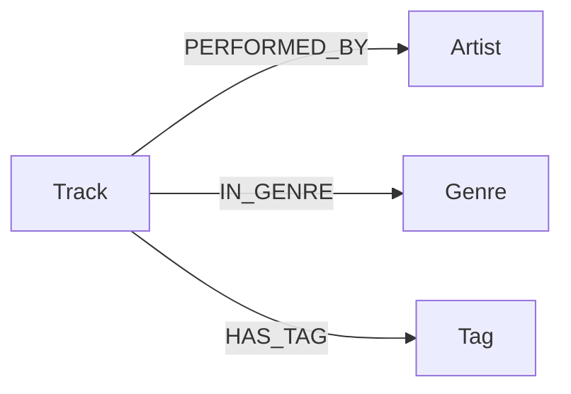

# SoundGraph | Sistema de recomendação musical

Projeto do bootcamp Neo4j e DIO. Recomendação de músicas por características de conteúdo, especialmente tags compartilhadas, utilizando Neo4j AuraDB e Cypher.

## Dataset

Fonte: [Million Song Dataset – Spotify / Last.fm (Kaggle)](https://www.kaggle.com/datasets/undefinenull/million-song-dataset-spotify-lastfm). Utilizamos somente `Music Info.csv`. Os CSVs tratados são importados localmente pela interface do Aura; credenciais e dados brutos não devem ser publicados. A licença da fonte deverá ser confirmada antes de redistribuir amostras.

## Modelo do grafo



## Importação no Aura

Em [Aura Console](https://console.neo4j.io/), abra Import e escolha CSV/TSV local. Adicione os seis arquivos tratados e crie os nós:

| Label | CSV | ID |
|---|---|---|
| Track | tracks.csv | track_id |
| Artist | artists.csv | name |
| Genre | genres.csv | name |
| Tag | tags.csv | name |

Preserve os nomes das colunas nas propriedades. Track: track_id, name, spotify_id como String; year, duration_ms, key, mode, time_signature como Integer; danceability, energy, loudness, speechiness, acousticness, instrumentalness, liveness, valence, tempo como Float. Artist, Genre e Tag: name como String. As colunas artist e genre de tracks.csv servem para mapeamento, sem necessidade de duplicá-las como propriedades.

| Relação (origem → destino) | CSV | Coluna de origem | Coluna de destino |
|---|---|---|---|
| Track → Artist: PERFORMED_BY | tracks.csv | track_id | artist |
| Track → Genre: IN_GENRE | track_genres.csv | track_id | genre |
| Track → Tag: HAS_TAG | track_tags.csv | track_id | tag |

Execute Run import após completar o mapeamento e selecione a instância do projeto.

## Validação após carga

```cypher
MATCH (n)
RETURN labels(n) AS label, count(*) AS total
ORDER BY total DESC;
```

```cypher
MATCH ()-[r]->()
RETURN type(r) AS relationship, count(*) AS total
ORDER BY total DESC;
```

Contagens esperadas com os seis CSVs verificados, em uma instância vazia: 50.683 Track, 8.317 Artist, 15 Genre, 100 Tag; 50.683 PERFORMED_BY, 22.348 IN_GENRE e 185.313 HAS_TAG. Total: 59.115 nós e 258.344 relacionamentos. A carga e essas contagens foram confirmadas no AuraDB.

## Recomendação explicável

- V1: quantidade de tags compartilhadas.
- V2: similaridade de Jaccard (interseção / união).
- V3: combinação de Jaccard (70% por padrão) e similaridade de cinco características sonoras (30%).
- Artist Discovery: Jaccard entre conjuntos de tags dos repertórios.
- Musical DNA: frequência das tags nas músicas de um artista.
- Graph Explorer: conexões que explicam uma recomendação.

A lógica reside no Cypher, sem GDS. Todos os candidatos precisam compartilhar pelo menos uma tag, inclusive quando o peso das tags é zero. Os pesos são heurísticos; scores não são probabilidades de preferência.

## Interface

A interface Streamlit usa o driver oficial Neo4j e consultas parametrizadas da pasta `cypher/`. Veja [como executar localmente](docs/run-app.md) e [resultados e troubleshooting](docs/validation.md).

## Status

Grafo importado e validado; três algoritmos, descoberta de artistas e explicabilidade testados no Aura. A interface está implementada nesta branch e ainda requer teste de integração. Amostra de dados (sujeita à licença), scripts de carga e screenshots finais ainda pendentes.
