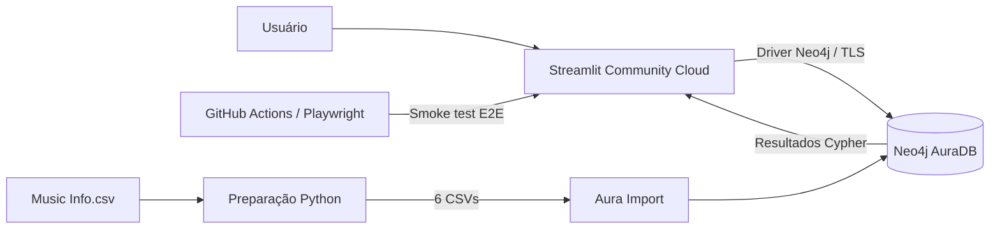
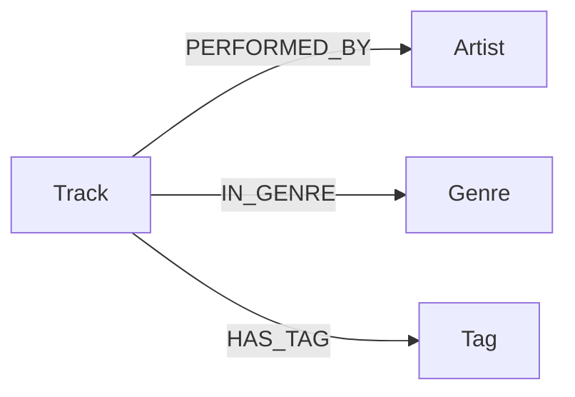
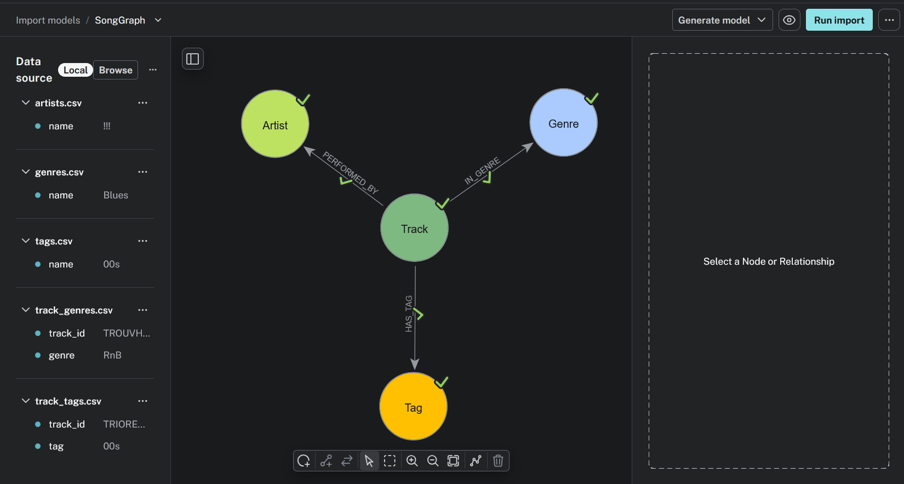
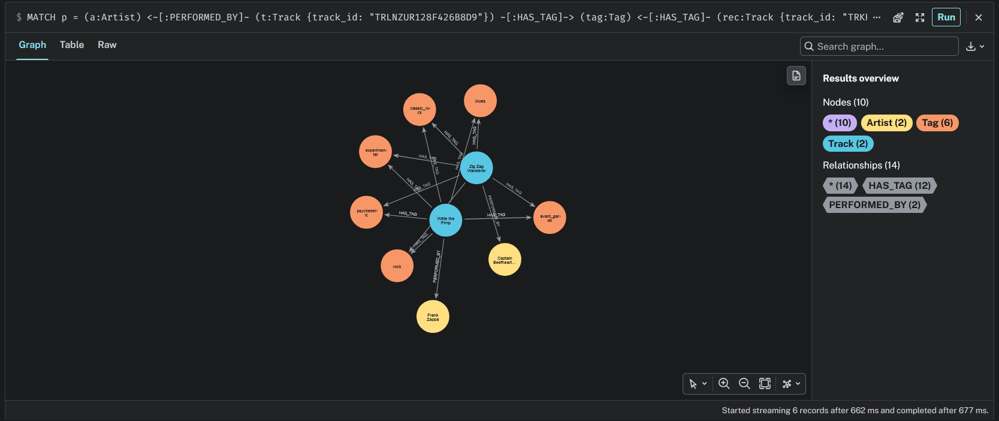

# SoundGraph


**Descubra música através de conexões.** Sistema de recomendação musical explicável em Neo4j e Cypher, desenvolvido para o bootcamp Neo4j + DIO.

[**Experimentar a aplicação**](https://soundgraph.streamlit.app/) · [English version](README.en.md) · [Validação](docs/validation.md)

[](https://github.com/mneves0988/sistema-recomendacao-musical/actions/workflows/soundgraph-smoke.yml)

> A demonstração usa planos gratuitos. O Streamlit pode hibernar; o AuraDB pode precisar de reativação pelo responsável. O smoke test temporário não garante disponibilidade contínua.

## Problema e solução

Como descobrir músicas e artistas relacionados sem depender de histórico de usuários? SoundGraph explora conexões explícitas entre faixas, artistas e tags, combinadas com características acústicas. Cada recomendação apresenta os elementos em comum que contribuíram para o ranking. O objetivo é demonstrar a modelagem e a consulta de um grafo real, não reproduzir um recomendador comercial.

| Músicas | Artistas | Nós | Relacionamentos |
| ---: | ---: | ---: | ---: |
| 50.683 | 8.317 | 59.115 | 258.344 |

## Funcionalidades

- **Track Discovery:** escolha artista e faixa; compare três métodos de recomendação, ajuste o peso do estilo e da sonoridade, explore as tags compartilhadas e acesse links do Spotify quando disponíveis.
- **Artist Discovery:** encontre artistas com perfis de tags semelhantes.
- **Musical DNA:** veja a frequência de tags no repertório disponível de um artista.
- **Graph Explorer:** visualize as conexões reais que explicam uma recomendação.

## Arquitetura



Python, Streamlit, Neo4j AuraDB, Cypher, Graphviz, GitHub Actions e Playwright. Não há GDS, LLM, API de recomendação externa nem histórico de ouvintes. Spotify é apenas um link opcional. O motor de recomendação reside no banco; a interface envia parâmetros e apresenta resultados.

## Modelo do grafo



| Entidade | Identificador | Quantidade |
|---|---|---:|
| Track | track_id | 50.683 |
| Artist | name | 8.317 |
| Genre | name | 15 |
| Tag | name | 100 |

| Relacionamento | Quantidade |
|---|---:|
| PERFORMED_BY | 50.683 |
| IN_GENRE | 22.348 |
| HAS_TAG | 185.313 |

Track contém atributos de áudio, ano, duração e identificador Spotify. O grafo mantém faixas sem tags ou gênero, sem inventar metadados ausentes.

## Métodos de recomendação

A expansão parte da faixa de referência e percorre tags compartilhadas até outras faixas, excluindo o artista original. O requisito de ao menos uma tag compartilhada vale para todos os métodos.

```cypher
MATCH (t:Track {track_id: $track_id})-[:PERFORMED_BY]->(original:Artist)
MATCH (t)-[:HAS_TAG]->(tag:Tag)<-[:HAS_TAG]-(rec:Track)-[:PERFORMED_BY]->(artist:Artist)
WHERE rec <> t AND artist <> original
RETURN rec.track_id AS id, rec.name AS track, artist.name AS artist,
       count(DISTINCT tag) AS shared_tags
ORDER BY shared_tags DESC, track ASC, id ASC
LIMIT $limit;
```

| Método | Lógica |
|---|---|
| V1 | Contagem de tags compartilhadas |
| V2 | Jaccard: interseção / união dos conjuntos de tags |
| V3 | Combinação ponderada de Jaccard e similaridade de áudio |

A similaridade de áudio é 1 menos a média das diferenças absolutas de cinco atributos em escala 0–1: energy, danceability, valence, acousticness e instrumentalness. O score híbrido é w × Jaccard + (1 − w) × áudio, com w = 0,70 por padrão. Os valores percentuais são medidas de similaridade, não probabilidades de preferência. As consultas completas estão em [cypher/](cypher/).

## Resultados observados no AuraDB

Com peso padrão (70% tags, 30% áudio):

| Referência | Primeira recomendação | Score híbrido |
|---|---|---:|
| Frank Zappa / Willie the Pimp | Captain Beefheart & His Magic Band / Zig Zag Wanderer | 62,71% |
| Daft Punk / Something About Us | Moby / Another Woman | 61,88% |
| Madonna / Justify My Love | Lady Gaga / Americano | 68,05% |
| Miles Davis / Saeta | Jaco Pastorius / Continuum | 97,30% |

No primeiro exemplo, as faixas compartilham seis tags, Jaccard de 54,55% e similaridade de áudio de 81,75%. O subgrafo explicativo possui 10 nós e 14 relacionamentos. O último exemplo tem apenas duas tags na faixa de referência, o que exige cautela na interpretação.

A [execução E2E nº 3](https://github.com/mneves0988/sistema-recomendacao-musical/actions/runs/45531869057) confirmou a URL pública, o catálogo do Neo4j, Zig Zag Wanderer com 62,71% e o Graph Explorer. O teste de navegador terminou em 18,1 s; a execução completa levou 92 s. Esses tempos são de uma execução, não benchmarks de latência ou carga.

## Evidências no Neo4j Aura

### Modelagem e importação



[Resultado da importação](docs/images/import-results.png) · [Schema do grafo](docs/images/graph-schema.png)

### Explicabilidade das recomendações



[Perfil musical do artista no Neo4j](docs/images/artist-musical-profile.png)

As imagens documentam o desenvolvimento no AuraDB; não são simulações nem capturas da versão final da interface web.

## Reproduzir o projeto

1. Baixe **Music Info.csv** da [fonte no Kaggle](https://www.kaggle.com/datasets/undefinenull/million-song-dataset-spotify-lastfm). Não é necessário baixar o histórico de ouvintes.
2. Prepare os dados com `python scripts/prepare_data.py "data/raw/Music Info.csv" data/processed`.
3. Importe em uma instância Aura vazia conforme o [guia visual de importação](docs/aura-import.md). A [alternativa programática](data/README.md) foi disponibilizada, mas ainda não foi testada no Aura.
4. Configure as credenciais localmente e execute a interface.

```powershell
py -3 -m venv .venv
.\.venv\Scripts\python.exe -m pip install -r requirements.txt
Copy-Item .env.example .env
notepad .env
.\.venv\Scripts\python.exe -m streamlit run app.py
```

Consulte [execução local](docs/run-app.md) e [preparação dos dados](data/README.md). Nunca versione o arquivo .env. O repositório contém uma pequena fixture sintética; o dataset real não é redistribuído enquanto suas condições de licença não forem confirmadas.

## Organização

| Caminho | Responsabilidade |
|---|---|
| app.py | Interface e integração com o Neo4j |
| assets/brand/ | Identidade visual oficial |
| cypher/ | Consultas de descoberta, explicação e validação |
| cypher/import/ | Constraints e carga alternativa |
| scripts/ | Preparação e importação programática |
| data/ | Documentação e fixture sintética |
| docs/ | Guias, validações e limitações |
| monitoring/ | Smoke test público na branch padrão |

## Limitações e segurança

- Recomendação baseada no conteúdo, não personalizada por comportamento de ouvintes. Pesos heurísticos, sem avaliação estatística de relevância.
- Metadados esparsos podem inflar Jaccard; faixas sem tags não participam das recomendações. Não há dados de álbuns neste escopo.
- A interface usa consultas parametrizadas, sessões de leitura e secrets fora do código. Sessões de leitura não equivalem a privilégios de leitura no servidor; a restrição efetiva da conta do Aura ainda não foi confirmada.
- O [monitoramento temporário](https://github.com/mneves0988/sistema-recomendacao-musical/blob/main/docs/monitoring.md) testa uma jornada real sem escrever no banco. Não impede necessariamente a pausa do AuraDB Free.

Projeto educacional do bootcamp Neo4j + DIO. Desenvolvido por Matheus Neves.
